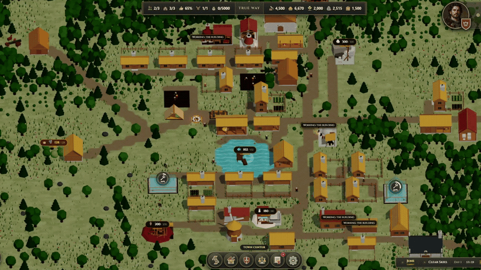
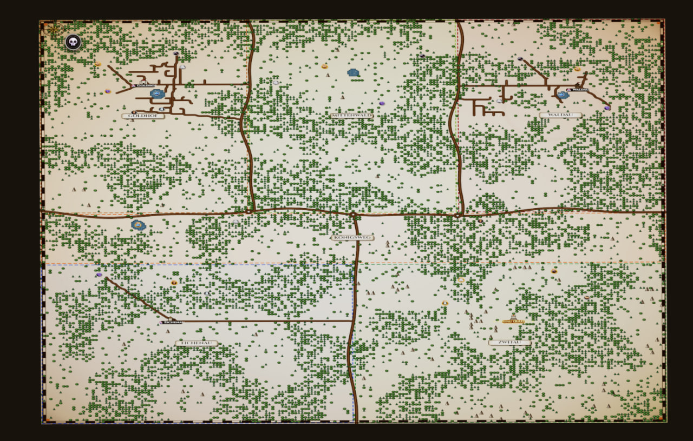

# Throne of Mud — 3D Medieval Colony Simulation

[](https://react.dev/)
[](https://www.typescriptlang.org/)
[](https://vitejs.dev/)
[](https://threejs.org/)
[](https://r3f.docs.pmnd.rs/)
[](https://github.com/hmans/miniplex)
[](https://zustand-demo.pmnd.rs/)
[](https://tailwindcss.com/)
[](https://developer.mozilla.org/en-US/docs/Web/API/Web_Audio_API)
[](https://developer.mozilla.org/en-US/docs/Web/API/IndexedDB_API)
[](https://www.khronos.org/opengl/wiki/OpenGL_Shading_Language)
[](https://oxc.rs/)

---

## Overview

**Throne of Mud** is an authentic medieval city-builder, feudal management, and colony simulation game rendered in real-time 3D WebGL via Three.js and React Three Fiber.

The current game includes a 384×384 world with six regions, 33 building blueprints, production and trading systems, mule-based hauling, autonomous rival settlements, diplomacy, militia squads, seasonal weather, animated wildlife, and local save games. The simulation uses an Entity Component System (ECS), while Three.js and React Three Fiber render the world in real time.

<p align="center">
  
</p>

---

## Tech Stack

### 3D Graphics & Simulation Engine
- **Three.js (r186) & React Three Fiber (v9)**: Real-time WebGL scene graph rendering, dynamic camera orchestration, instanced mesh batching, and procedural geometry.
- **Custom GLSL Shader Pipeline**: Multi-texture terrain splatting (`grass`, `mud`, `stone`, `water`, `road`), dynamic rain wetness, procedural splash rings, seasonal foliage color shifts, winter snow accumulation, animated water waves, and GPU vertex-shader wind physics.
- **Miniplex v2 (Entity Component System)**: Simulation systems for jobs, movement, needs, wages and markets, production, immigration, trade, rival lords, and bandits.
- **A* Pathfinding (`AStar.ts`)**: Fast heuristic path planning supporting obstacle avoidance, dynamic door alignments, and regional highway constraints.

### State Management & Architecture
- **Zustand v5 (Slice Pattern)**: Game state is divided into `timeSlice`, `settlementSlice`, `diplomacySlice`, `uiSlice`, and `audioSlice`.
- **Project Modules**: React UI and 3D renderers live in `src/components/`, simulation and pathfinding in `src/engine/`, state in `src/store/`, translations in `src/i18n/`, and save handling in `src/services/storage/`. See [docs/ARCHITECTURE.md](docs/ARCHITECTURE.md) for the architecture guide.

### UI, Audio & Storage
- **React 19, Tailwind CSS v4 & Lucide React**: Medieval HUD, building and character inspectors, parchment menus, custom icons, and asset folders for buildings, militia, portraits, cursors, textures, and branding under `public/assets/ui/`.
- **Web Audio API (`AudioManager.ts`)**: Spatial and ambient audio with separate volume settings.
- **Ukrainian and English (`src/i18n/`)**: Interface translations, with localized speech bubbles and diplomatic letters.
- **IndexedDB (`saveManager.ts`)**: Manual and automatic local saves of the world, entities, resources, and progress; language and audio preferences use `localStorage`.
- **Vite 8, Oxlint & Electron 44**: Browser development and production builds, linting, and Windows desktop packaging through electron-builder.

---

## Key Features

<p align="center">
  
</p>

### Expanded Feudal Realm & Geopolitical Regions (384×384)
- **6 Regions**: *Goldhof*, *Mittenwald*, *Waldau*, *Königsweg / Royal Highway*, *Eichenau*, and *Zweiau*. The player can select a starting region and one of its settlement sites.
- **Regional Resources**: Iron, stone, clay, salt, berries, game, and fishing waters support extraction and food production.

### Trade Economy & Royal Highway Caravans
- **Trading Posts (`trading_post`)**: Configure imports, exports, desired reserves, and trade prices for individual goods.
- **Traveling Merchants**: Autonomous horse-drawn merchant wagons traversing the Royal Highway network to trade across fiefs.
- **Road Network**: Settlements can lay roads and connect with the Royal Highway for merchant visits.

### Working Beasts & Mule Logistics
- **Hitching Posts (`hitching_post`)**: Each post supports up to three working mules.
- **Log Towing & Material Hauling**: Workers take mules from a post, collect logs or construction supplies, deliver them, and return the animals.

### Multi-Tier Medieval Production Chains
- **33 Building Blueprints**:
  - *Forestry & Extraction*: Lumberjack Hut, Sawmill, Stone Quarry, Stonecutter, Clay Pit, Brickworks, Salt Works, Iron Mine, Charcoal Kiln, Iron Smelter.
  - *Agriculture & Food*: Forager's Hut, Hunter's Hut, Fisherman's Hut, Wheat Farm, Windmill, Bakery, Brewery.
  - *Civic & Residential*: Peasant Houses, Settler Tents, Campfire, Hitching Post, Stockpile, Marketplace, Tavern, Wooden Church, Lord's Manor, and defensive walls, gates, and barracks.
- **Upgradeable Housing**: Peasant houses have three tiers with room for two, three, or four residents. Backyards can produce vegetables, eggs, meat, hides, weapons, or ale through gardens, animal pens, and artisan workshops.

### Autonomous AI Rival Lords
- **Up to 4 Rival Lords**: New-game setup offers zero to four opponents, including *Baron von Berg*, *Lady Hildegard*, *Duke Wilhelm*, and *Count von Reichenbach*.
- **Autonomous Expansion**: AI lords build roads, workplaces, housing and backyard extensions, upgrade houses, and manage workers and immigration. Diplomacy includes letters, relations, peace, passage rights, war, and territorial claims.

### Settler Vitality, Social Life & Daily Routines
- **Needs & Economy**: Villagers manage hunger, energy, mood, and ale needs while earning wages and buying goods at the market.
- **Daily Schedules & Night Gathering**: Settlers work daytime shifts, gather around campfires at dusk, and sleep in beds at night.
- **Jobs & Pathfinding**: Workers are assigned to construction, extraction, farming, crafting, hauling, and civic work; A* navigation routes them around obstacles.
- **Speech Bubbles**: Job announcements, mood remarks, and proclamations appear above characters and follow the selected UI language.

### 12-Month Calendar, Weather & Dynamic Seasons
- **Authentic 12-Month Year (March–February)**: 4 seasons, 10 days per month (120 days/year), full 24-hour sun/moon illumination arcs.
- **Multi-Stage Weather System**: Clear skies, overcast rain with ground wetness, thunderstorms with lightning, and winter snow.
- **Seasonal Transformations**: Lighting, weather, vegetation, and snow change through the year; deer, hares, foxes, boars, and birds animate across the map.

### Strategic Parchment Map & Game Setup
- **Interactive Setup Modal**: Choose a region and spawn point, name the ruler and realm, select a portrait and heraldry, and configure the starting season, supplies, scenario, and 0 to 4 rival lords.
- **Parchment Map View (`M`)**: Seamless transition into a top-down parchment map displaying borders, heraldry shields, roads, and demographic stats.

<p align="center">
  
</p>

### Unified Foliage & Real-Time Road Paving
- **Instanced Foliage Rendering**: Thousands of swaying trees, bushes, grass tufts, and flowers with vertex-shader wind physics.
- **Dynamic Road Tool (`R`)**: Freeform road drawing with automatic foliage and clutter clearance.
- **Militia & Threats**: Form spearman, swordsman, archer, and pikeman squads; rally, move, or disband them while roaming bandits travel the map.

---

## In-Game Controls & Hotkeys

| Key | Action | Description |
| :--- | :--- | :--- |
| **`W` `A` `S` `D` / Arrows** | Camera Pan | Pan across the settlement and landscape |
| **`Q` / `E`** | Rotate Camera / Building | Rotate camera angle left / right, or rotate building blueprint during placement |
| **Mouse Wheel** | Zoom In / Out | Smooth altitude zoom (tactical to aerial view) |
| **Right Mouse Drag** | Orbit / Rotate | Rotate camera angle and pitch |
| **`Space`** | Pause / Resume | Toggle simulation loop |
| **`1`** | FPS Monitor | Show or hide the performance monitor; it starts hidden |
| **`2` / `3`** | Game Speed | Switch to 2x or 5x; select 1x from the time controls |
| **`T`** | Town Center Focus | Center camera on Lord's camp / manor |
| **`R`** | Road Tool | Toggle dirt road drawing and erase mode |
| **`M`** | Strategic Map | Toggle top-down parchment map view |
| **`V`** | Militia | Open or close the militia panel |
| **`L`** | Guide | Open or close the in-game guide |
| **`F2`** | Weather Debug | Toggle the weather debug panel |
| **`Escape`** | Settings / Close | Close active panel or open settings modal |

---

## Running Locally

### Prerequisites
- **Node.js**: `^20.19.0` or `>=22.12.0` (the installed Vite requirement; tested with Node v24.20)
- **npm**: Install a version supported by your Node.js release

### Installation & Development

```bash
# From the repository root, install dependencies
npm install

# Start the Vite development server
npm run dev
```

The game client will be available at [http://localhost:5173](http://localhost:5173).

### Building for Production

```bash
# Typecheck and compile production bundle
npm run build

# Preview production build locally
npm run preview
```

For the desktop version, run `npm run electron:dev` during development or `npm run electron:build` to produce Windows NSIS and portable packages. Browser output is written to `dist/`; desktop packages are written to `release/`.

### Linting & Code Hygiene

```bash
# Run ultra-fast Oxlint check
npm run lint
```

---

## License

This project is open-source and available under the [MIT License](LICENSE).
