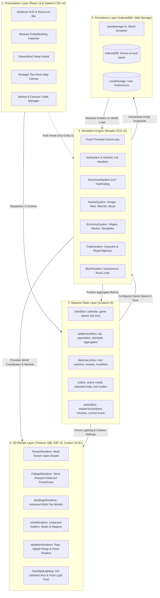
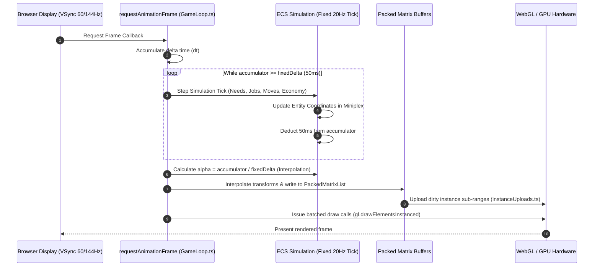
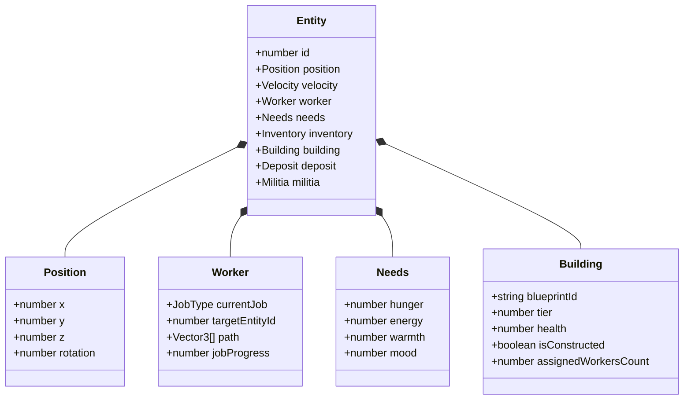

# System Architecture & Technical Specifications

This document outlines the high-level software architecture, data pipelines, and design patterns powering **Throne of Mud**.

---

## 1. High-Level Architectural Layers

Throne of Mud is engineered with a strict **5-Tier Decoupled Architecture**. Each tier has a well-defined boundary and communicates with neighboring tiers through explicit, typed contracts.



---

## 2. Simulation vs. Render Decoupling

A critical architectural pillar of Throne of Mud is the **strict separation between the simulation frequency and the render display refresh rate**.



### Key Properties:
1. **Deterministic Physics & AI:** Running systems at a fixed $20\text{ Hz}$ ($\Delta t = 0.05\text{ s}$) guarantees identical simulation outcomes regardless of whether the user plays on a $60\text{ Hz}$, $144\text{ Hz}$, or variable refresh rate (VRR) monitor.
2. **Smooth Visual Presentation:** When rendering at high frame rates, visual positions are interpolated between the previous and current simulation ticks using the remaining fractional accumulator ($\alpha$), preventing visual jitter.

---

## 3. Entity Component System (ECS) Architecture

Throne of Mud leverages **Miniplex v2**, a minimalist, high-performance Entity Component System. Entities are pure JavaScript objects; components are properties attached to them.



Queries in Miniplex compile to fast cached sets. Systems iterate exclusively over matching entities:
```typescript
// Example: Movement system query
const movingEntities = world.with("position", "velocity", "path");
for (const entity of movingEntities) {
  // Execute movement logic without checking irrelevant entities
}
```

---

## 4. 3D Graphics Pipeline & Instanced Batching

To achieve real-time $60\text{ FPS}$ performance in a dense medieval colony with thousands of trees, dozens of buildings, and hundreds of citizens, **draw calls are strictly capped**:

```mermaid
flowchart LR
    subgraph Entities ["World Entities"]
        U[150 Settlers & Mules]
        B[40 Multi-Tier Buildings]
        F[3,000 Trees, Bushes & Rocks]
    end

    subgraph BatchingEngine ["Batching Infrastructure"]
        UBatches[AnimatedMeshBatches.ts]
        BBatches[HouseMultiDrawBatches.ts / BuildingMeshBatches.ts]
        FBatches[FoliageRenderer.tsx]
        MatrixBuffer[PackedMatrixList (Float32Array)]
    end

    subgraph GPUOutput ["GPU Draw Pipeline"]
        DrawUnits[2-4 Instanced Draw Calls]
        DrawBuildings[8-12 Instanced Draw Calls]
        DrawFoliage[4-6 Instanced Draw Calls]
        DrawTerrain[1 Draw Call Multi-Splat Terrain]
    end

    U --> UBatches --> MatrixBuffer --> DrawUnits
    B --> BBatches --> MatrixBuffer --> DrawBuildings
    F --> FBatches --> MatrixBuffer --> DrawFoliage
```

- **Building Instancing (`HouseMultiDrawBatches.ts`)**: Instead of rendering 40 individual house models containing roofs, walls, beams, chimneys, and doors (which would trigger $>800$ separate draw calls), parts are grouped by shared material into unified `InstancedMesh` buffers.
- **Dynamic Terrain Splatting (`TerrainRenderer.tsx`)**: The entire $384\times 384$ terrain is rendered in a single draw call. A custom GLSL fragment shader reads a procedural splat texture and blends grass, mud, rock, riverbed, and roads seamlessly with slope and height heuristics.
- **GPU Wind & Season Shaders**: Tree foliage and grass blades sway dynamically in the vertex shader using simplex noise uniforms without any CPU animation overhead.

---

## 5. Persistence & Save Architecture

Game state persistence is managed by `src/services/storage/saveManager.ts` using **IndexedDB**:

1. **State Dehydration**: When saving, the active Miniplex ECS world entities, world heightmap mutations, road grid arrays, and Zustand settlement aggregates are serialized into a compact JSON snapshot.
2. **Atomic Write Transactions**: Saves are written to the `throne-of-mud-saves` IndexedDB object store with timestamped keys. A rollback mechanism prevents save file corruption if the browser tab is abruptly closed during serialization.
3. **Save Migrations**: Every snapshot includes a `schemaVersion` (e.g., `1`). On load, if the save version is older than current engine requirements, migration pipelines execute sequentially to normalize missing component fields.

For in-depth details on the schema and entity dehydration, refer to [`docs/SAVE_FORMAT.md`](SAVE_FORMAT.md).
