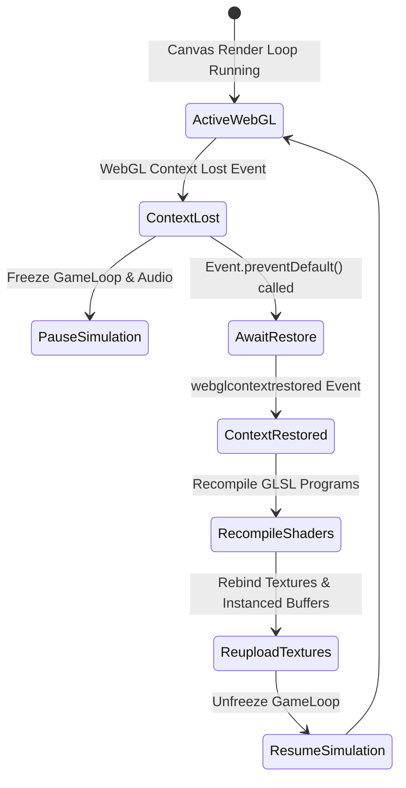
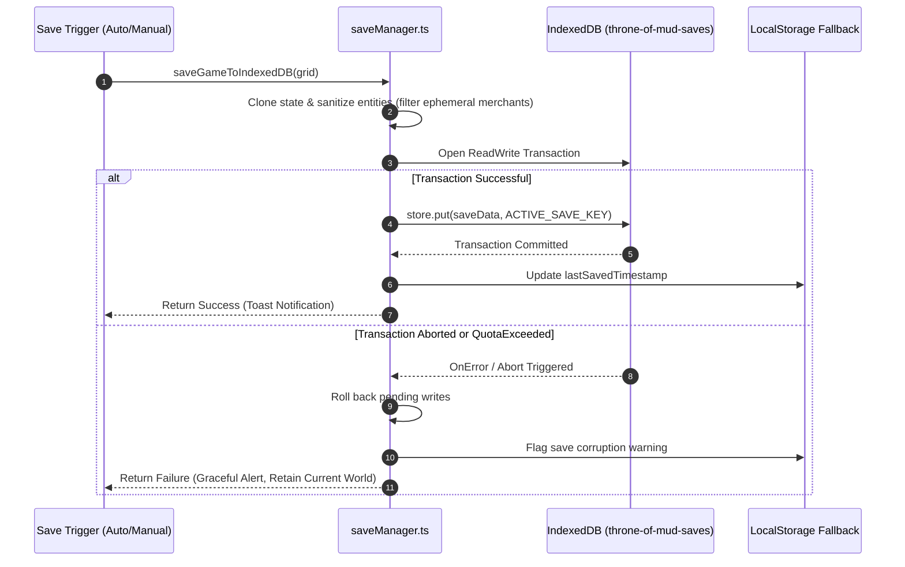
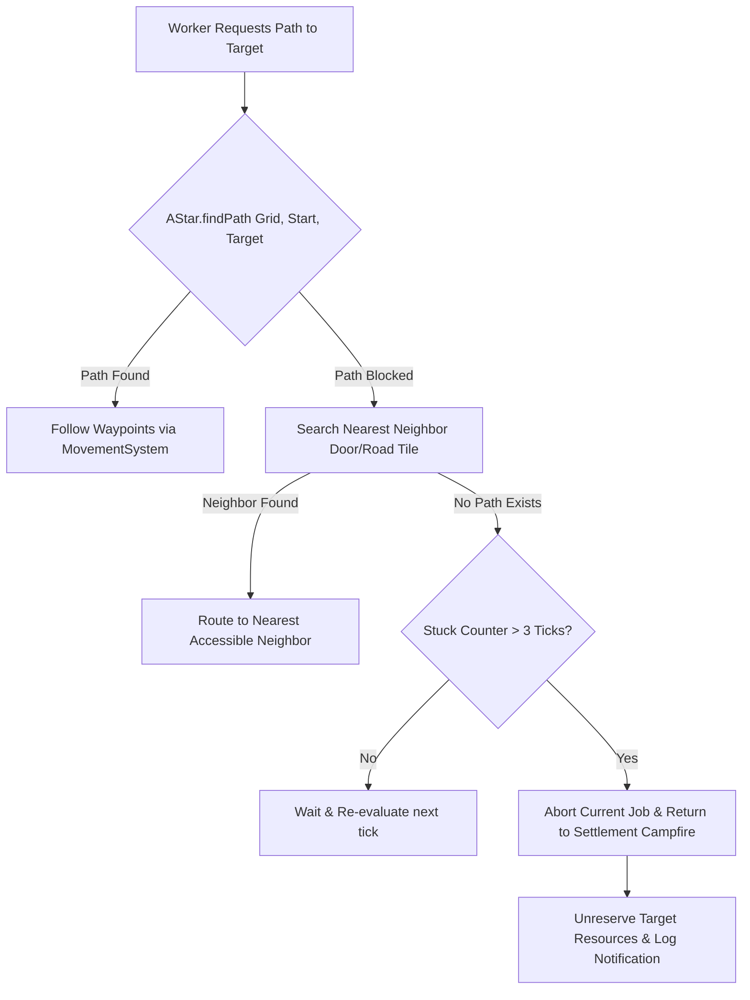

# Failure Recovery & Resilience Architecture

This document details the error-handling strategies, WebGL fault recovery, save corruption mitigations, and pathfinding failovers implemented across **Throne of Mud**.

---

## 1. WebGL Context Loss & Recovery

In browser WebGL games, the graphics driver may reset due to GPU overheating, driver updates, or OS sleep/wake cycles (`webglcontextlost` event).

### Recovery Invariants:
1. **Prevent Default:** The canvas listener intercepts `webglcontextlost` and calls `event.preventDefault()`. This signals the browser to attempt context restoration instead of permanently killing the canvas.
2. **Buffer Rehydration:** When `webglcontextrestored` triggers, Three.js geometries and custom GLSL shader uniforms are invalidated and recompiled. `PackedMatrixList` instances are re-uploaded from the ECS world state.
3. **Audio Panning Reset:** The Web Audio API context (`AudioContext`) is checked for suspended state (`audioCtx.state === 'suspended'`) and resumed upon user gesture or canvas recovery.

---

## 2. Save Corruption & IndexedDB Fault Tolerance

Save operations occur in the background during auto-saves and manual exits. Corrupting a player's save file due to browser crashes or quota limits is unacceptable.

### Fault Protections:
- **Exclusion of Transient Entities:** Traveling merchants (`factionId === 'merchant'`) and dynamic particle entities are stripped before serialization. This prevents orphaned pointers or duplicate caravans upon reload.
- **Save Schema Migration:** If a save was created on an older version of the schema, `saveManager.ts` runs sequential field migration checks (e.g. populating missing `militiaSquads` or `playerIdentity` with defaults) instead of throwing runtime `TypeError` exceptions.
- **Quota Exceeded Fallback:** If browser storage quota is reached, an alert prompts the player to clear older autosaves rather than crashing silently.

---

## 3. Pathfinding Failover & Stuck Agent Recovery

In a dynamic 384×384 grid where players can construct buildings and walls at any time, workers or pack mules may occasionally get trapped or separated from their destinations.

### Protection Mechanisms:
- **Dynamic Re-Routing:** If a building blueprint is placed directly across a moving unit's path, `MovementSystem` detects the blockage at the next waypoint and recalculates via `AStar`.
- **Stuck State Discard:** If a worker cannot reach a tree or stockpile after 3 consecutive attempts, the worker drops the assignment, releases reserved inventory locks, and returns to the campfire or tavern.
- **Regional Highway Guarantee (`ensureEichenauSettlementAccess`):** World generation enforces an open, non-obstructed corridor connecting starting settlement sites with the Royal Highway network.
