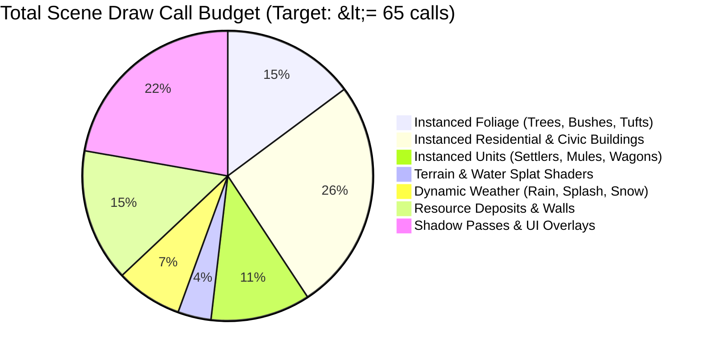

# Performance Budget & Optimization Invariants

This document establishes the **hardware targets, frame time budgets, draw call ceilings, and memory allocation invariants** for **Throne of Mud**.

---

## 1. Target Hardware & Frame Budgets

Throne of Mud is designed to achieve fluid 60 FPS gameplay on standard modern laptops and desktop machines:

| Metric | Target (Standard) | High Refresh / Gaming | Fallback (Low-Spec) |
| :--- | :--- | :--- | :--- |
| **Target Frame Rate** | **60 FPS** | **120 / 144 FPS** | **30 FPS** |
| **Total Frame Time Budget** | **16.66 ms** | **6.94 – 8.33 ms** | **33.33 ms** |
| - *Simulation & ECS Tick* | $\le 4.0\text{ ms}$ | $\le 2.0\text{ ms}$ | $\le 8.0\text{ ms}$ |
| - *Matrix Packing & Buffer Sync* | $\le 2.5\text{ ms}$ | $\le 1.0\text{ ms}$ | $\le 5.0\text{ ms}$ |
| - *WebGL Draw & GPU Execution* | $\le 8.0\text{ ms}$ | $\le 4.0\text{ ms}$ | $\le 16.0\text{ ms}$ |
| - *React UI Layout & Reconciliation* | $\le 1.5\text{ ms}$ | $\le 0.5\text{ ms}$ | $\le 3.0\text{ ms}$ |

---

## 2. Draw Call Budget & Batching Architecture

Uncontrolled draw calls are the #1 killer of WebGL performance. In Throne of Mud, **the entire scene is rendered under strict draw call limits**:



### Batching Invariants:
1. **Never Render Individual Meshes in Loops:**
   - Any object appearing $>3$ times in the scene (trees, houses, peasants, cows, walls) **must** use `THREE.InstancedMesh`.
2. **Modular House Multi-Draw (`HouseMultiDrawBatches.ts`):**
   - A single peasant house is composed of timber beams, plaster walls, thatched roof, brick chimney, and doors.
   - Instead of 40 houses emitting $40 \times 6 = 240$ draw calls, the system batches all wall sub-geometries into one draw call, all roof sections into another, and all chimneys into a third. The total draw call count for 100+ houses remains **under 10**.
3. **Paging & Distance Culling (`BUILDING_VISIBILITY`, `FOLIAGE_PAGING`):**
   - Visibility distance dynamically scales based on camera zoom:
     $$\text{dist} = \max(\text{minDistance}, \min(\text{maxDistance}, \frac{\text{zoomScale}}{\text{zoom}} + \text{margin}))$$
   - Objects outside the camera frustum or distance cutoff are excluded from matrix updates.

---

## 3. Memory & Garbage Collection Invariants

Garbage collection (GC) pauses cause sudden micro-stutters and frame drops. In the hot loop, **zero heap allocations are tolerated**:

### Rule 3.1: Zero Allocations in `useFrame` & Tick Loops
- **Prohibited:**
  ```typescript
  // BAD: Allocating new objects/arrays inside the render/tick loop
  useFrame(() => {
    const target = new THREE.Vector3(x, y, z); // Triggers GC!
    const active = entities.filter(e => e.isActive); // Creates new Array!
  });
  ```
- **Mandated:**
  ```typescript
  // GOOD: Scratch vector reused across frames
  const SCRATCH_VEC = new THREE.Vector3();
  useFrame(() => {
    SCRATCH_VEC.set(x, y, z);
  });
  ```

### Rule 3.2: Typed Array Re-Use (`PackedMatrixList.ts`)
- Transformation matrices for instanced units and props are packed sequentially into pre-allocated `Float32Array` buffers.
- Buffers grow with geometric doubling ($2\times$) and are never re-allocated unless the capacity is strictly exceeded.

### Rule 3.3: Point Light Clamping (`StablePointLightPool.ts`)
- Dynamic Three.js point lights (torches, campfires, forge fires) are expensive due to forward lighting calculations.
- Lights are pooled with a minimum allocation (`POINT_LIGHT_POOL.minSlots = 16`). Distant lights smoothly fade out and release their pool slot, with a 30-second shrink hysteresis to prevent thrashing.

---

## 4. Automated Performance Regressions

All pull requests and commits are validated against our automated batching and performance scripts in `scripts/`:

```bash
# Validates house multi-draw batch limits
node scripts/check-house-batching.mjs

# Asserts unit and wagon instancing integrity
node scripts/check-unit-batching.mjs

# Checks foliage instance packing density
node scripts/check-foliage-packing.mjs

# Ensures point lights stay strictly within pool capacity
node scripts/check-point-light-range.mjs
```
