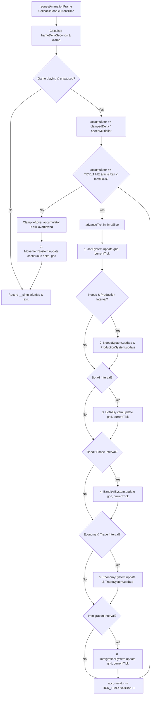

# Simulation Tick & Game Loop Architecture

This document specifies the tick lifecycle, system dispatch ordering, timestep accumulation, and throttling mechanisms in the **Throne of Mud** engine (`src/engine/time/GameLoop.ts`).

---

## 1. Overview & Timing Constants

The game loop is driven by `requestAnimationFrame` with a fixed-rate simulation accumulator. Visual frames run at the monitor's native refresh rate (e.g. 60Hz / 144Hz), while discrete simulation logic steps at a deterministic tick frequency:

| Parameter | Value | Definition |
| :--- | :--- | :--- |
| `TICK_RATE` | `SIMULATION.ticksPerSecond` | Base frequency of discrete game logic (e.g. 10–20 Hz) |
| `TICK_TIME` | `1.0 / TICK_RATE` | Delta time per simulation step ($\Delta t$) |
| `maxFrameDeltaSeconds` | `0.1`s (100ms) | Clamps elapsed time during heavy lag spikes / tab switching |
| `maxTicksPerFrame` | Dynamic ($\approx \text{speedMultiplier}$) | Safety cap preventing spiral-of-death when FPS drops |

---

## 2. Tick Lifecycle Flowchart

---

## 3. System Dispatch & Staggering Strategy

To guarantee stable frame times without CPU execution spikes, heavy simulation systems use **interval staggering** and **phase offsetting**:

### A. Core Systems (Every Tick)
- **`JobSystem.update(grid, currentTick)`**:
  - Evaluates worker state transitions.
  - Sub-handlers dispatched:
    - `ConstructionJobHandler` (placing foundation, carrying timber, building structure)
    - `HaulingJobHandler` (transporting goods to stockpiles, mule hitching)
    - `WoodcuttingJobHandler` & `GatheringJobHandler` (tree falling, berry picking)
    - `WorkstationJobHandler` & `RestJobHandler` (crafting, sleeping)

### B. Periodic & Staggered Systems
When running at standard speed, systems run on cadence. When running at accelerated speeds ($2\times$, $5\times$), non-critical background systems are throttled to run every $N$-th tick (`SIMULATION.needsAndProductionInterval`):
- **Needs & Production (`NeedsSystem`, `ProductionSystem`)**:
  - Depletes hunger, warmth, energy; accumulates fatigue.
  - Ticks crafting and blueprint recipes (bakery flour $\to$ bread, smelter iron ore $\to$ ingots).
- **Faction AI (`BotAISystem`)**:
  - Evaluates territorial claims, blueprint placements, and worker assignments for rival AI lords.
- **Bandits (`BanditAISystem`)**:
  - Staggered with an explicit phase offset (`SIMULATION.banditPhase`) so that AI lords and bandits never compute intensive path planning on the exact same tick.
- **Economy & Trade (`EconomySystem`, `TradeSystem`)**:
  - Updates market reserves, computes equilibrium supply/demand prices, moves Royal Highway merchant carts.
- **Immigration (`ImmigrationSystem`)**:
  - Assesses settlement happiness, housing vacancies, and spawns new peasant families at realm borders.

### C. Continuous Movement System (`MovementSystem.update`)
Unlike discrete job state mutations, `MovementSystem` runs **per frame** using the actual elapsed frame delta (`clampedDelta * time.speedMultiplier`). It steps unit coordinates along their computed A* waypoints, ensuring buttery smooth movement at $60/144\text{ FPS}$ without artificial discrete stepping.

---

## 4. Spiral-of-Death Protection

If the browser experiences an extreme lag spike (e.g. garbage collection pause or tab backgrounding):
1. `frameDeltaSeconds` is clamped to `SIMULATION.maxFrameDeltaSeconds` ($0.1\text{ s}$).
2. The number of ticks allowed in a single frame is strictly limited to `maxTicksPerFrame`.
3. If leftover accumulated time still exceeds `TICK_TIME` after running the max permitted ticks, the accumulator is dropped to zero (`this.accumulator = 0`). This prevents the engine from trying to catch up on hundreds of overdue ticks, which would otherwise freeze the browser.
