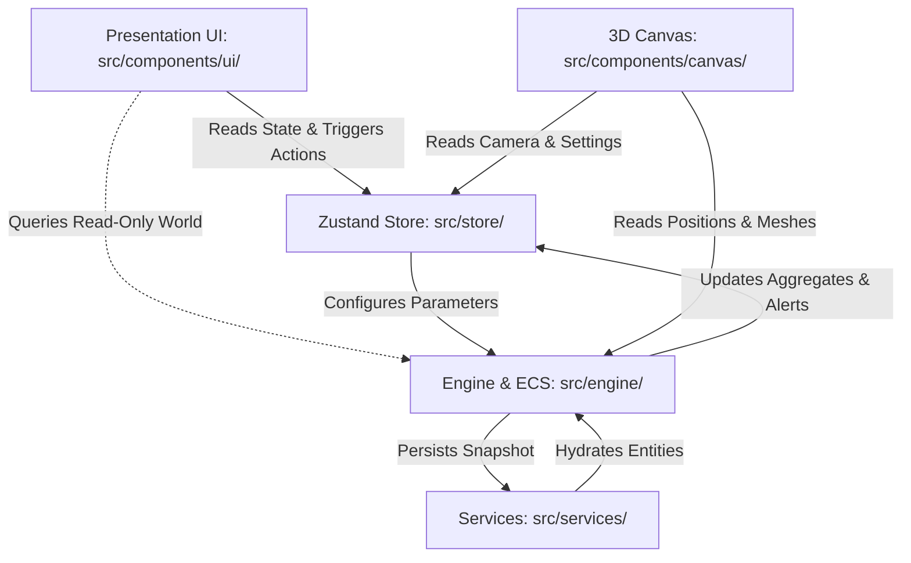

# Repository Structure & Subsystem Boundaries

This document provides a comprehensive overview of the **Throne of Mud** directory layout, component responsibilities, and modular boundary invariants.

---

## Directory Hierarchy

```
throne-of-mud/
├── .github/                         GitHub actions workflows & PR templates
│   └── PULL_REQUEST_TEMPLATE.md     Standard checklist for contributions
├── docs/                            System engineering documentation & specifications
│   ├── adr/                         Architectural Decision Records (ADR-001 - ADR-005)
│   ├── systems/                     Detailed subsystem architecture guides
│   ├── ARCHITECTURE.md              High-level system design & layer boundaries
│   ├── FAILURES_AND_RECOVERY.md     Context loss, save corruption & fault recovery
│   ├── PERFORMANCE_BUDGET.md        Draw call limits, memory & GC invariants
│   ├── SAVE_FORMAT.md               IndexedDB schema, entity dehydration & migrations
│   ├── SIMULATION_TICK.md           Game loop tick lifecycle & system dispatch order
│   └── STRUCTURE.md                 This file
│
├── electron/                        Desktop packaging wrapper
│   ├── main.cjs                     Electron main process with secured IPC
│   └── preload.cjs                  Preload bridge with context isolation
│
├── public/                          Static assets served directly
│   └── assets/                      Textures, portraits, cursors, UI icons, audio
│
├── scripts/                         Build tools & automated performance assertions
│   ├── check-building-batching.mjs  Validates generic building instancing
│   ├── check-house-batching.mjs     Validates modular multi-tier house draw batches
│   ├── check-unit-batching.mjs      Validates settler, mule, and wagon batch matrices
│   ├── check-foliage-packing.mjs    Asserts tree/grass GPU buffer packing density
│   ├── check-point-light-range.mjs  Ensures active dynamic lights stay within budget
│   └── patch-electron-builder.cjs   Build pipeline compatibility patch
│
└── src/                             Application source code
    ├── components/                  React UI & WebGL 3D rendering
    │   ├── audio/                   Spatial audio controller & listener sync
    │   ├── canvas/                  Three.js & React Three Fiber scene graph
    │   │   ├── buildings/           Instanced building renderers & geometry models
    │   │   │   ├── common/          Shared procedural geometry primitives
    │   │   │   └── models/          Civic, food, housing, logistics & production 3D models
    │   │   ├── fauna/               Ambient wildlife renderers (deer, foxes, birds)
    │   │   ├── performance/         GPU frame timer, batch caches & light pools
    │   │   ├── units/               Instanced settlers, wagons, mules & animations
    │   │   ├── BuildingsRenderer.tsx
    │   │   ├── DayNightLighting.tsx
    │   │   ├── FoliageRenderer.tsx
    │   │   ├── GameCanvas.tsx
    │   │   ├── TerrainRenderer.tsx
    │   │   └── WeatherRenderer.tsx
    │   ├── common/                  Error boundaries, guards, toast notifications
    │   └── ui/                      React HUD, menus, trade sheets & inspectors
    │       ├── bottom-bar/          Building category dock, time controls, speed
    │       ├── inspector/           Contextual inspector for units, buildings, resources
    │       ├── settings/            Audio volume sliders, graphics settings, language
    │       ├── trade/               Marketplace & trading post management sheets
    │       ├── MainMenu.tsx         Game launch & save selection screen
    │       ├── NewGameSetupModal.tsx Realm customization & geopolitical setup
    │       └── StrategicMapModal.tsx Parchment top-down geopolitical map
    │
    ├── constants/                   Static configuration values
    │   ├── audio.ts                 Sound assets, channel gains & roll-off distances
    │   ├── colors.ts                Medieval palette definitions & badge themes
    │   ├── economy.ts               Base prices, wage curves & consumption rates
    │   ├── rendering.ts             Draw distance thresholds, shadow tiers, FOV
    │   └── time.ts                  Ticks per day, season lengths, calendar months
    │
    ├── engine/                      Pure simulation engine (Headless-capable)
    │   ├── assets/                  Asset preloader & texture loader utilities
    │   ├── audio/                   Web Audio API synthesis & sound management
    │   ├── buildings/               Blueprint definitions, dimensions, validation & snapping
    │   ├── combat/                  Militia squads, tactical formations & attack logic
    │   ├── ecs/                     Miniplex Entity Component System
    │   │   ├── systems/             Tick systems (Job, Move, Needs, Economy, BotAI, etc.)
    │   │   │   └── jobs/            Modular job handlers (Hauling, Construction, etc.)
    │   │   ├── entityHelpers.ts     Entity creation, query filters & state mutations
    │   │   └── world.ts             Miniplex World instantiation & component schemas
    │   ├── grid/                    Discrete 384x384 world grid, heightmap & road routing
    │   ├── pathfinding/             Heuristic A* implementation with terrain weights
    │   ├── resources/               Natural deposits (iron, stone, clay, salt, berries)
    │   ├── time/                    Game loop, fixed timestep accumulator, pause/speed
    │   ├── trade/                   Caravan routes, Royal Highway pricing & tariffs
    │   └── world/                   Procedural terrain generation, rivers & biomes
    │
    ├── i18n/                        Localization engine
    │   ├── en.json                  English localization strings
    │   ├── uk.json                  Ukrainian localization strings
    │   └── useTranslation.ts        Hook & reactive translation dictionary
    │
    ├── services/                    Cross-cutting infrastructure services
    │   └── storage/                 IndexedDB persistence & save migration engine
    │       └── saveManager.ts       Serializes/deserializes world snapshots
    │
    ├── store/                       Global state management
    │   ├── slices/                  Modular Zustand state slices
    │   │   ├── audioSlice.ts        Bus volumes, mute flags, active ambient soundscape
    │   │   ├── diplomacySlice.ts    Rival lord relations, war states & treaty flags
    │   │   ├── settlementSlice.ts   Global stockpiles, population counts, tax rates
    │   │   ├── timeSlice.ts         Calendar day/month, daylight angle, pause state
    │   │   └── uiSlice.ts           Active inspector, selected entity, active modal
    │   ├── types.ts                 Unified state interface & action contracts
    │   └── useGameStore.ts          Central Zustand store composition
    │
    └── types/                       TypeScript domain types & enum declarations
        ├── buildings.ts             Blueprint schemas & building states
        ├── economy.ts               Good types, resource categorizations
        ├── entities.ts              Component types and entity declarations
        └── world.ts                 Tile types, terrain coordinates, weather states
```

---

## Architectural Boundary Invariants

To keep the codebase maintainable and prevent spaghetti coupling, the following unidirectional flow rules are enforced across subsystem boundaries:



### Invariant 1: Headless Simulation Engine
`src/engine/` must remain completely independent of React and DOM rendering APIs. It must only depend on pure JavaScript/TypeScript data structures, math utilities, and Miniplex. This allows running unit tests, simulation benchmarks, or headless node scripts without initializing a DOM or WebGL context.

### Invariant 2: Rendering is a Pure Observer
`src/components/canvas/` reads ECS positions, orientations, and states to update GPU buffer attributes (`InstancedMesh.setMatrixAt`, uniforms). The 3D render layer **never alters gameplay state directly**; user interactions (clicks on 3D objects) dispatch high-level intents to the Zustand store or ECS command queue.

### Invariant 3: Single Source of Truth for Entity State
All entity attributes (health, current job, position, inventory, hunger) live in the Miniplex ECS `world`. The Zustand store holds UI and global settlement totals (e.g. total timber stored, active game speed, selected entity ID), but **never duplicates individual entity component fields**.
