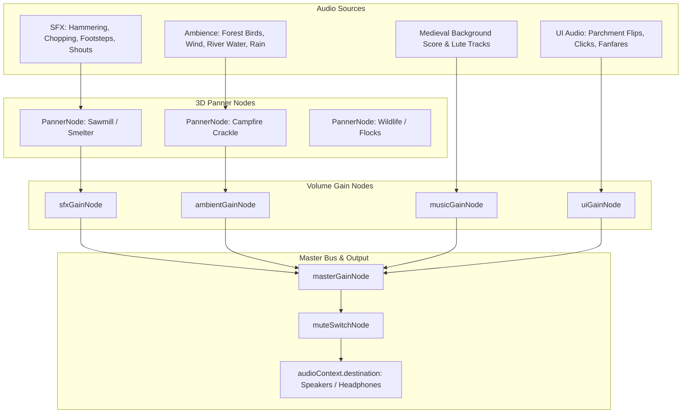

# Subsystem: Web Audio Engine & Spatial Sound

This document details the audio routing architecture, spatial 3D positioning, and dynamic environmental soundscapes managed by `src/engine/audio/AudioManager.ts` and `src/components/canvas/SpatialAudioListener.tsx`.

---

## 1. Audio Graph & Bus Routing

Throne of Mud builds a modular audio bus graph on top of the native **Web Audio API (`AudioContext`)**:



---

## 2. 3D Spatial Audio & Camera Listener

To deliver immersive medieval colony audio, sound emitters attenuate based on their distance and position relative to the camera:

### Spatial Listener Synchronization (`SpatialAudioListener.tsx`):
1. In the R3F render loop, the camera's world position and forward/up vectors are forwarded to `audioManager.updateListener(cameraPosition, forwardVector, upVector)`.
2. Emitters utilize `PannerNode` with an **inverse distance model**:
   - `refDistance = 10` meters
   - `maxDistance = 80` meters
   - `rolloffFactor = 1.2`
3. When panning the camera across the colony, sound sources (e.g. blacksmith hammer strikes, sawmill waterwheel turns) pan accurately between stereo channels and attenuate naturally when zooming out into tactical view.

---

## 3. Dynamic Environmental Soundscape (`AreaMetrics`)

The ambient audio layer dynamically crossfades based on the player's camera location and zoom level:

```typescript
export interface AreaMetrics {
  villageDensity: number;      // Density of nearby buildings
  forestDensity: number;       // Proximity to dense tree canopies
  waterProximity: number;      // Distance to rivers/lakes
  campfireProximity: number;   // Distance to active campfires
  zoom: number;                // Tactical zoom altitude
  camX: number;
  camZ: number;
}
```

- **High Village Density:** Fades in settlement chatter, animal whinnies, and construction clatter.
- **High Forest Density:** Crossfades into birdsong and rustling leaf winds.
- **Water Proximity:** Increases gentle river wave lapping and frog croaks.
- **High Zoom (Aerial View):** Low-pass filters high-frequency ground sounds and elevates distant atmospheric wind gusts.

---

## 4. Browser Autoplay & AudioContext Lifecycle

Browsers restrict audio playback until user interaction:
- The `AudioContext` initializes in suspended state.
- The first user interaction (clicking "New Game", "Continue", or interacting with the menu) executes `audioContext.resume()`.
- If the browser tab loses focus, the audio engine smoothly ramps volume down over 200ms to avoid abrupt clicks or pops.
