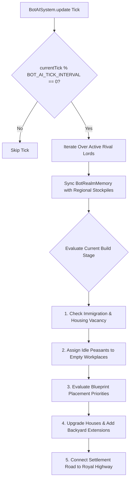

# Subsystem: Autonomous Rival Lords & Faction AI

This document details the architectural design and decision cycles of autonomous AI rival lords (`src/engine/ecs/systems/BotAISystem.ts`) and roaming bandit factions (`src/engine/ecs/systems/BanditAISystem.ts`).

---

## 1. Overview & Faction Personas

In **Throne of Mud**, the player can configure between 0 and 4 autonomous rival lords during realm setup:
1. **Baron von Berg** (Aggressive expansion, heavy fortifications, quarrying priority)
2. **Lady Hildegard** (Agricultural focus, large granaries, high diplomacy threshold)
3. **Duke Wilhelm** (Mercantile focus, rapid Royal Highway road connectivity, trading posts)
4. **Count von Reichenbach** (Feudal levies, iron mining, weaponsmithing)

Each lord rules their own sovereign geopolitical region with private stockpiles, peasant workers, building projects, and military levies.

---

## 2. Bot AI Decision Lifecycle

The AI operates on a staggered tick cadence to prevent frame time spikes:

### Staggered Decision Intervals:
- **`BOT_AI_BUILD_DECISION_INTERVAL`**: Evaluates constructing new buildings (lumberjack $\to$ campfire $\to$ farm $\to$ houses $\to$ stonecutter $\to$ trading post).
- **`BOT_AI_WORKER_ASSIGN_INTERVAL`**: Scans for unassigned workers and reallocates them to critical shortages (e.g. food production when food reserves $< 15$).
- **`BOT_AI_IMMIGRATION_INTERVAL`**: Spawns immigrant settler families at the territory border when available beds and food allow.

---

## 3. Intelligent Road Generation & Highway Connection

AI lords do not build in isolation; they integrate with the realm's logistics network:
- **Camp Approach Clearance (`hasOpenedCampApproaches`):** Clears trees and boulders immediately surrounding the lord's camp to establish building corridors.
- **Highway Paving (`getSmartRoadPath`):** Traces an optimal A* path from the bot's town center to the closest node of the **Royal Highway** (*Königsweg*), paving dirt roads. This allows traveling merchant caravans to visit the AI settlement and trade goods.

---

## 4. Bandit Faction Mechanics (`BanditAISystem.ts`)

Bandits act as dynamic world antagonists operating in the wilderness and unclaimed forests:
- **Phase Offset Execution:** Bandits update on an offset tick phase (`SIMULATION.banditPhase`) so that pathfinding computations never coincide with AI lord build decisions.
- **Target Evaluation:** Bandits scout for isolated peasant workers gathering wood far from settlement walls or lone merchant wagons traveling along unpatrolled stretches of the highway.
- **Raid & Retreat:** When engaging, bandits attempt to pillage resources before retreating into the deep woods. Player or rival lord militia squads can be mobilized to intercept them.
