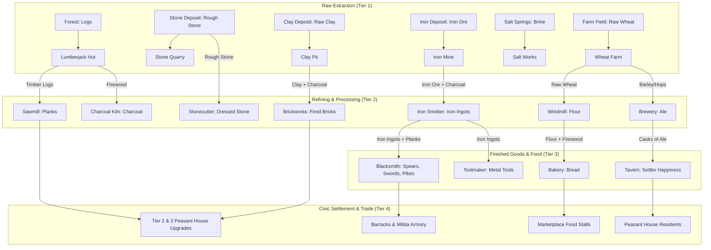
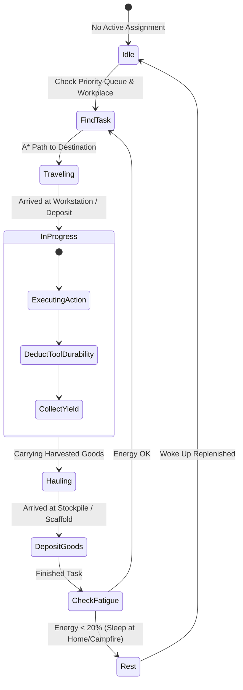

# Subsystem: Feudal Economy, Jobs & Trade Logistics

This document specifies the resource supply chains, worker job lifecycle, pack mule logistics, and Royal Highway market trade mechanics in `src/engine/`.

---

## 1. Multi-Tier Production Chains

Throne of Mud models authentic medieval supply chains, transforming raw natural resources into finished goods, foodstuffs, and armaments across **33 building blueprints**:

---

## 2. Worker Job Lifecycle & Handlers

Settlers receive tasks through `JobSystem.update`, which delegates to specialized modular handlers:

### Key Job Handlers:
- **`ConstructionJobHandler`**: Validates materials delivered to building footprints. Once all timber and stone are present, workers assemble the scaffold and construct the building.
- **`HaulingJobHandler`**: Directs workers to transfer goods from production sites to central stockpiles. When dealing with heavy logs, workers prioritize utilizing available working mules.
- **`WoodcuttingJobHandler` & `GatheringJobHandler`**: Handles terrain clearing, felling timber, and gathering wild berries or game meat.
- **`WorkstationJobHandler`**: Manages crafting recipes at mills, bakeries, smelters, and artisan backyard workshops.

---

## 3. Working Beasts & Mule Logistics

To solve the logistics bottleneck of transporting heavy logs across large distances:
1. **Hitching Posts (`hitching_post`)**: Houses up to 3 working pack mules.
2. **Log Towing Mechanics**:
   - A worker assigned to haul timber navigates to the nearest hitching post.
   - The worker hitches a mule (`worker.hasMule = true`), proceeds to the felled tree, hitches the heavy log behind the mule, and hauls it to the sawmill or construction site.
   - Upon delivery, the worker returns the mule to the hitching post, ensuring beasts of burden remain available for other town tasks.

---

## 4. Royal Highway Caravans & Foreign Trade

The Royal Highway (*Königsweg*) cuts across the realm, connecting the player's colony with distant fiefdoms and autonomous AI lords:

- **Trading Posts (`trading_post`)**:
  - The player sets trade policies for each good: *Import*, *Export*, or *No Trade*.
  - A desired local stockpile reserve is configured (e.g. "Export timber only when reserve $> 50$").
- **Merchant Wagons**:
  - Autonomous horse-drawn merchant wagons travel along the Royal Highway.
  - Upon reaching a colony's trading post, transactions execute against the player's gold treasury according to current supply/demand market pricing.
