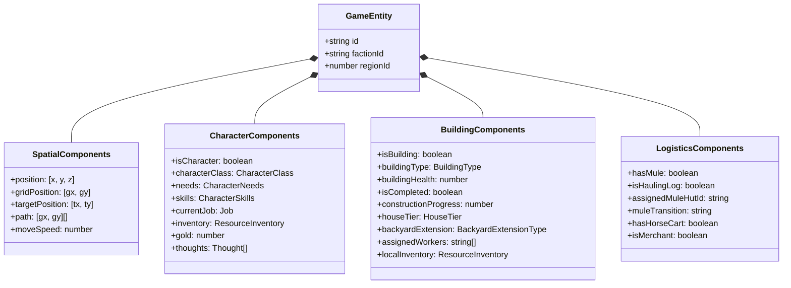

# Subsystem: Miniplex ECS Core Architecture

This document specifies the Entity Component System (ECS) implementation using **Miniplex v2** in `src/engine/ecs/world.ts` and `src/engine/ecs/entityHelpers.ts`.

---

## 1. Architectural Philosophy

Throne of Mud avoids classical Object-Oriented inheritance hierarchies (e.g. `class Peasant extends Character extends MovableEntity`) in favor of **Data-Oriented Composition**:
- **Entity (`GameEntity`):** A lightweight container with a unique string `id`.
- **Components:** Pure, serializable data properties (e.g., `position`, `needs`, `inventory`, `buildingType`).
- **Archetype Views (`world.with(...)`):** Cached, reactive entity sets indexed by active components.
- **Systems:** Stateless functions running in the game loop that query entities and mutate state.

---

## 2. Miniplex Archetype Queries

To eliminate redundant checks, Miniplex maintains live, reactive subsets of entities:

```typescript
export const world = new World<GameEntity>();

// Living citizens with needs and physical coordinates
export const characterEntities = world.with('isCharacter', 'position', 'gridPosition', 'needs');

// Completed and under-construction buildings
export const buildingEntities = world.with('isBuilding', 'position', 'gridPosition', 'buildingType');

// Resource nodes (iron mine, stone quarry, clay pit, salt works)
export const resourceDepositEntities = world.with('isResourceDeposit', 'position', 'gridPosition');

// Entities currently traversing waypoints
export const movingEntities = world.with('position', 'gridPosition', 'path');
```

When an entity receives a new component (e.g. `world.addComponent(entity, 'path', waypoints)`), Miniplex automatically adds it to `movingEntities`. When the path completes, removing the component evicts it from the query set with zero overhead.

---

## 3. Component Taxonomy



---

## 4. Entity Lifecycle & Helper Methods

All entity creation and mutations are routed through `entityHelpers.ts` to enforce component invariants:

| Helper Function | Responsibility |
| :--- | :--- |
| `createSettler(pos, class, factionId)` | Spawns a new villager with default needs, empty inventory, and starting gold. |
| `createBuildingEntity(type, gridPos, rotation)` | Spawns a blueprint scaffold entity with required construction materials. |
| `assignJobToWorker(worker, job)` | Sets `worker.currentJob`, reserves destination workstation slots, and computes path. |
| `deliverMaterialsToConstruction(worker, building)` | Transfers wood/stone from worker inventory to `deliveredMaterials` and increments progress. |
| `removeEntity(entity)` | Releases assigned workers, clears reserved tiles in `GridMap`, and destroys entity from `world`. |
