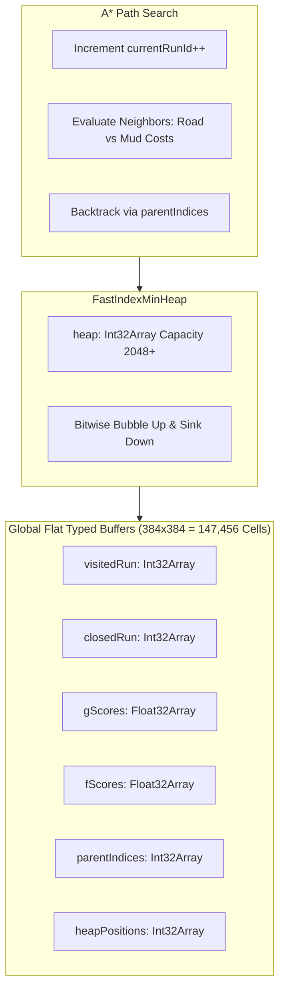

# Subsystem: A* Pathfinding Engine

This document details the high-performance navigation and path planning system implemented in `src/engine/pathfinding/AStar.ts`.

---

## 1. High-Performance Design Invariants

Standard JavaScript A* implementations suffer from severe Garbage Collection churn due to creating thousands of node objects (`{ x, y, g, h, f, parent }`) per search. 

Throne of Mud employs a **Flat Typed Array & Monotonic Run ID** architecture:



### 1.1. Monotonic Run ID (Zero Array Clear Overhead)
Instead of re-zeroing 147,456 array elements between path requests:
```typescript
let currentRunId = 1;
// To check if a cell was visited in the current search:
const isVisited = visitedRun[cellIndex] === currentRunId;
// To mark as visited:
visitedRun[cellIndex] = currentRunId;
```
Clearing state for a new search costs a single integer increment (`currentRunId++`), taking **$\approx 0\text{ ns}$**.

### 1.2. Fast Index Min-Heap (`FastIndexMinHeap`)
- Open set is managed via a binary min-heap stored in a flat `Int32Array`.
- Index locations in the heap are tracked in `heapPositions`, enabling $O(\log N)$ decrease-key updates when a cheaper route to an already-open cell is discovered.

---

## 2. Terrain Weights & Movement Costs

Path costs consider ground friction and travel speed:

| Terrain / Tile State | Base Movement Cost | Notes |
| :--- | :--- | :--- |
| **Paved Road / Dirt Road** | **$0.6$** | Settlers & pack mules strongly prioritize roads for transit. |
| **Grass / Meadow** | **$1.0$** | Standard baseline traverse cost. |
| **Forest / Foliage** | **$1.4$** | Minor impedance through tree thickets. |
| **Mud / Swamp** | **$2.0$** | Saturated muddy soil slows movement. |
| **Water / River** | **$\infty$ (Blocked)** | Impassable unless a bridge is constructed. |
| **Constructed Building / Wall** | **$\infty$ (Blocked)** | Solid obstacle impassable to all units. |

---

## 3. Dynamic Door Alignments & Area Navigation

Units interacting with buildings (e.g. delivering timber to a sawmill or buying bread at a bakery) do not navigate to the center of the structure (which is blocked by building geometry).

### `findPathToArea` Algorithm:
1. When targeting a building with footprint $W \times H$:
2. The algorithm calculates the **perimeter cells** surrounding the footprint ($dx \in [-1, W], dz \in [-1, H]$).
3. Walkable perimeter candidates adjacent to designated doors or road access points are sorted by Euclidean distance to the starting position.
4. Pathfinding routes to the optimal accessible entrance tile.

---

## 4. Unreachable Cache & Early Exit

To prevent burning CPU cycles recalculating impossible paths (e.g., trying to reach an enclosed island or a walled compound with no gate):
- Failed destination pairs are recorded in `unreachableByGrid` (`WeakMap<GridMap, Set<string>>`).
- Subsequent requests to the same blocked destination abort immediately until world geometry or wall destruction invalidates the cache.
