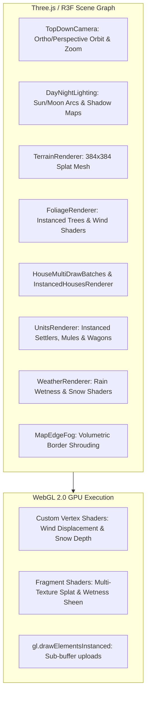
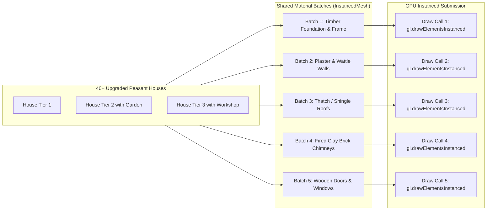

# Subsystem: 3D Render Pipeline & Shaders

This document details the Three.js r186, React Three Fiber v9, and custom GLSL rendering pipeline in `src/components/canvas/`.

---

## 1. Graphics Pipeline Overview

---

## 2. Multi-Texture Terrain Splatting (`TerrainRenderer.tsx`)

The $384\times 384$ terrain grid is rendered as a continuous plane displaced by an elevation heightmap. Rather than relying on hundreds of individual terrain tiles, the entire terrain is drawn in a single draw call with a multi-texture splatting GLSL shader.

### Splat Shader Mechanics:
1. **Texture Atlas / Uniform Channels:**
   - Channel 0: `uGrassTexture` (temperate meadow)
   - Channel 1: `uMudTexture` (trodden earth & tracks)
   - Channel 2: `uStoneTexture` (rocky cliffs & mountain slopes)
   - Channel 3: `uWaterTexture` (rivers and lake shores)
   - Channel 4: `uRoadTexture` (paved & cobblestone roads)
2. **Procedural Splat Weighting:**
   - Slopes exceeding $35^\circ$ automatically blend into cliff rock (`uStoneTexture`).
   - Elevations below river base level blend into sand/water.
   - Active road tiles (`tile.hasRoad === true`) paint the road texture with procedural edge falloff and dirt grit.

---

## 3. Instanced Building Multi-Draw Architecture

Buildings in Throne of Mud are assembled from modular procedural parts (stone foundations, timber frames, wattle-and-daub plaster walls, thatched roofs, chimneys, and wooden doors). 

Rendering each building as an individual hierarchy of meshes would result in hundreds of draw calls. Throne of Mud solves this via **Multi-Draw Instancing** (`HouseMultiDrawBatches.ts` and `BuildingMeshBatches.ts`):

### Partial Matrix Buffer Updates (`instanceUploads.ts`):
When a building is upgraded or constructed, only its sub-range within the `Float32Array` instance matrix buffer is invalidated, avoiding full-buffer CPU-to-GPU re-uploads every frame.

---

## 4. Seasonal & Dynamic Weather Shaders

The seasonal cycle (Spring, Summer, Autumn, Winter) and weather phenomena (Rain, Thunderstorm, Snow) are rendered via shader uniforms:

1. **Vertex Wind Physics:**
   Foliage leaves, branch geometry, and tall grass blades oscillate using a vertex shader function:
   $$vDisplacement = \sin(position.x \cdot 0.5 + uTime \cdot uWindSpeed) \cdot uWindStrength \cdot (uv.y)^2$$
   Squaring $uv.y$ anchors the tree trunk to the ground while allowing the canopy to sway freely.
2. **Winter Snow Accumulation:**
   In winter, surfaces with normal vectors facing upwards ($N \cdot (0, 1, 0) > 0.4$) gradually accumulate white snow in the fragment shader, increasing with `uSnowCover` uniform depth.
3. **Dynamic Wetness Sheen & Rain Splashes:**
   Rain increases surface specular reflectance and darkens the albedo roughness map to simulate saturated, muddy ground. Animated circular ripple rings expand across water surfaces.
